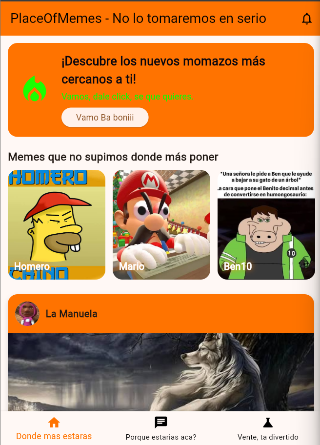
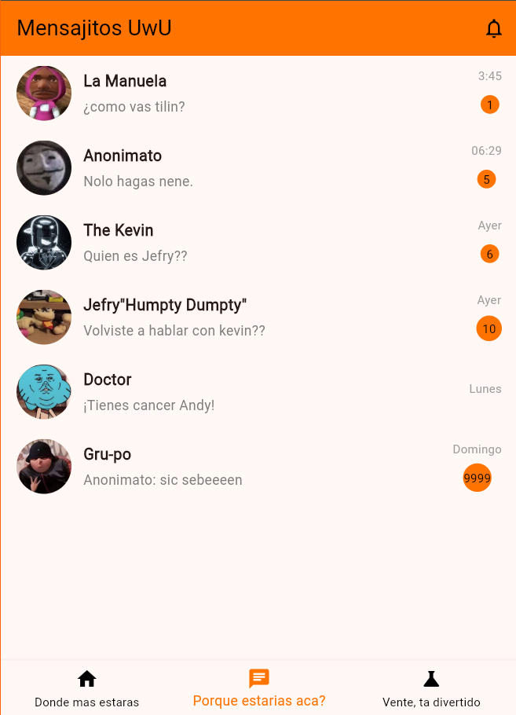
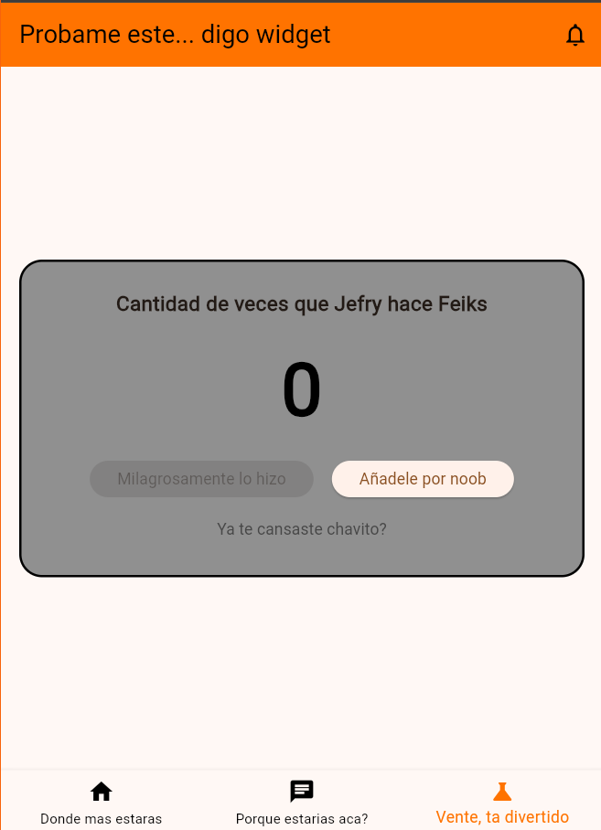

# taller2docorte
# PlaceOfMemes

Aplicación móvil desarrollada con Flutter y Dart para el taller práctico de desarrollo móvil.

## Descripción
App con tres secciones navegables mediante BottomNavigationBar:
- **Home:** banner promocional, carrusel horizontal y publicaciones (PostCard) con botón "Me gusta".
- **Chats:** lista de conversaciones con el widget ChatTitle.
- **Laboratorio de widgets:** contador interactivo con setState() y límites.

## Cómo ejecutarlo
1. Instalar Flutter: https://docs.flutter.dev/get-started/install
2. Clonar el repositorio: `git clone <https://github.com/Thiago83sss/Taller2doCorte-Moviles.git>`
3. Entrar a la carpeta: `cd taller2docorte`
4. Instalar dependencias: `flutter pub get`
5. Ejecutar en un emulador o dispositivo: `flutter run`

## Capturas

### Home

### Chats

### Laboratorio de widgets

## Autor
Ivan Santiago Romero Cepeda.
